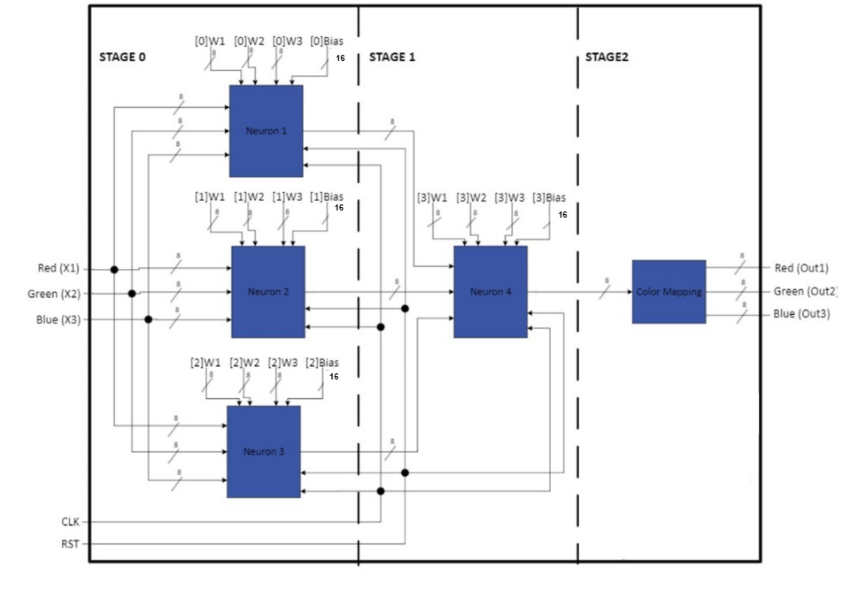
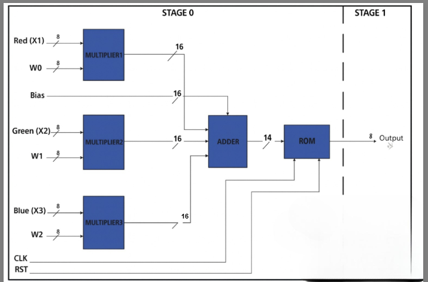
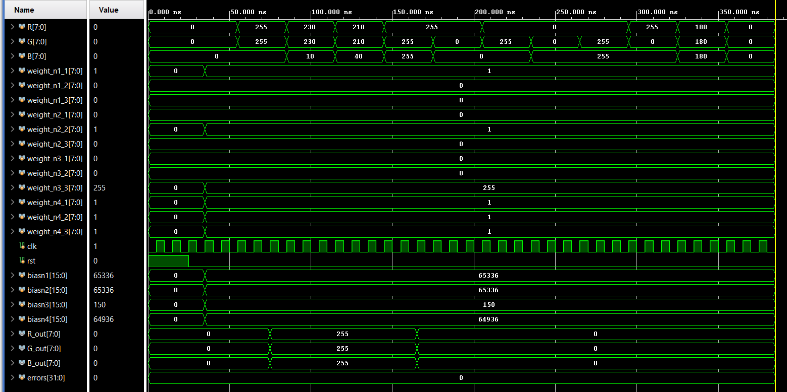

# Neural-Network Video Processing Block: Yellow Pixel Detection (Verilog)

A small hardware neural network that classifies RGB pixels. Yellow pixels come out **white** (255,255,255), and everything else comes out **black** (0,0,0). The design is written in Verilog. Each neuron uses fixed-point multipliers, a saturating adder, and a sigmoid activation stored in a ROM lookup table.

This was a team project for COMPE 572 at San Diego State University (Fall 2025). The parts I built are listed under [My contributions](#my-contributions).

## Tools

- **Verilog HDL:** RTL design and testbenches
- **Xilinx Vivado (XSim):** behavioral simulation and waveform checks
- **Cadence Xcelium (`xrun`) + SimVision:** simulation and waveform debug
- **Cadence Virtuoso:** symbols, transistor-level schematics, layout, DRC/LVS, and extraction
- **Python:** sigmoid lookup-table generation

## Architecture



There are four neurons in two layers, followed by a color-mapping stage:

| Neuron | Weights (R, G, B) | Bias | What it measures |
|---|---|---|---|
| N1 | (1, 0, 0) | -200 | How red the pixel is: `R - 200` |
| N2 | (0, 1, 0) | -200 | How green the pixel is: `G - 200` |
| N3 | (0, 0, -1) | +150 | How *not* blue the pixel is: `150 - B` |
| N4 | (1, 1, 1) on N1-N3 outputs | -600 | Fires only when all three are strong, which means yellow |

**Color mapping** outputs white when N4's activation is ≥ 200 and black otherwise.

### Inside a neuron



1. **Multiplier** (`multiplier_stage.v`): unsigned 8-bit pixel × signed 8-bit weight → signed 16-bit product.
2. **Adder** (`Adder.v`): adds the three products and the bias in 18 bits. It then applies a gain of 64 (`<<< 6`) to sharpen the sigmoid and saturates to a signed 14-bit range of −8192 to +8191.
3. **Sigmoid ROM** (`ROM_design.v`): a 16,384 × 8 lookup table. It offsets the 14-bit sum by +8192 to form the address, and its registered output is the 8-bit activation (0-255).

Each neuron has one clock of latency (the ROM register), so a pixel takes two clocks to pass through the network.

## Repo layout

```
rtl/       multiplier_stage, Adder, ROM_design, neuron_design,
           color_mapping_design, main_block_design (top)
tb/        one testbench per module
scripts/   sigmoid_values_14bit.py  - generates the sigmoid LUT
           run_xrun.sh              - Cadence Xcelium / SimVision run
           run_sim.sh               - quick run with Icarus Verilog (free)
mem/       sigmoid_values_14bit.hex - pre-generated LUT
docs/      block diagrams and waveforms
```

## Running it

**Vivado:**

1. Add `rtl/*.v` as design sources.
2. Add `tb/*.v` and `mem/sigmoid_values_14bit.hex` as simulation sources. Vivado copies the hex file into the simulation directory, which is where `$readmemh` looks for it.
3. Set the testbench you want as the simulation top, then run a behavioral simulation.

**Cadence Xcelium / SimVision:**

```bash
./scripts/run_xrun.sh main_block_tb        # batch run
./scripts/run_xrun.sh main_block_tb gui    # opens SimVision
```

**Without licensed tools:** `./scripts/run_sim.sh` runs every testbench in Icarus Verilog.

## Results

Running `main_block_tb` gives:

```
[85000] yellow_strong  RGB=(255,255,0) -> out=(255,255,255)  WHITE
[115000] yellow_mid  RGB=(230,230,10) -> out=(255,255,255)  WHITE
[145000] yellow_soft  RGB=(210,210,40) -> out=(255,255,255)  WHITE
[175000] white  RGB=(255,255,255) -> out=(0,0,0)  BLACK
[205000] red  RGB=(255,0,0) -> out=(0,0,0)  BLACK
[235000] green  RGB=(0,255,0) -> out=(0,0,0)  BLACK
[265000] blue  RGB=(0,0,255) -> out=(0,0,0)  BLACK
[295000] cyan  RGB=(0,255,255) -> out=(0,0,0)  BLACK
[325000] magenta  RGB=(255,0,255) -> out=(0,0,0)  BLACK
[355000] gray  RGB=(180,180,180) -> out=(0,0,0)  BLACK
[385000] black  RGB=(0,0,0) -> out=(0,0,0)  BLACK
ALL TESTS PASSED
```

All three shades of yellow are detected, and every other color is rejected. Pure white is the tricky case: its R and G are high, but N3 sees the high blue and pulls N4 negative. Vivado (XSim) and Xcelium/SimVision give the same results.



The same run in SimVision is in [docs/images/main_block_simvision_waveform.png](docs/images/main_block_simvision_waveform.png).

## Beyond RTL

The project then took the same system through the full custom flow in Cadence Virtuoso:

- **Transistor-level schematics** for every building block: AND/OR/NAND/NOR/XOR gates, half and full adders, a 16-bit ripple-carry adder, an 8×8 array multiplier, 1-bit and 4-bit magnitude comparators, a 2:1 MUX, and the 8-bit color-mapping block.
- **Layout and sign-off:** layouts from primitive gates up through the 16-bit adder, the 8×8 multiplier, and the color-mapping blocks.
  - DRC was clean on every delivered layout.
  - LVS passed on all primitive and intermediate blocks, the 16-bit adder, and the 1-bit color-mapping block.
  - Extracted views were generated for post-layout correlation.
- **Estimates:**
  - Core area was ≈ 9,373 µm² from schematics and ≈ 11,060 µm² after layout, an 18% increase from routing and power rails.
  - Sub-block speeds were 49.99 MHz for the 8×8 multiplier, 12.44 MHz for the 16-bit adder, and 8.33 MHz for the 8-bit color mapper.
  - Power at the ~8 MHz operating point rose ≈ 24% after layout because of routing capacitance and buffering.

## My contributions

- **Multiplier stage:** designed the RTL, wrote the testbench, and verified it in Vivado and SimVision.
- **Sigmoid ROM:** co-developed the activation ROM and its Python LUT generator.
- **Top-level hierarchy:** created the top-level Cadence symbol and the design hierarchy down to the sub-blocks.
- **Color-mapping schematic:** built the transistor-level design from a 1-bit comparator and a 2:1 MUX.
- **Basic gates:** validated the gate-level building blocks with testbenches (shared task).
- **Layout:** laid out the inverter and AND gate with DRC/LVS, and co-developed the 8×8 multiplier layout.
- **Performance analysis:** compared post-layout results against the schematic and analyzed the degradation (shared task).

## Notes

- **LUT scale:** `sigmoid_values_14bit.py` uses `SCALE = 512`, which reproduces the simulation results. With 1024, the `yellow_soft` test fails.
- **Threshold:** color mapping thresholds at 200, which is what the RTL uses. Early design notes mention 128.
- **Timescale:** every file starts with `` `timescale 1ns/1ps `` (the Vivado default), so the code simulates the same way in any simulator.

## References

- Marco Winzker, [NN_RGB_FPGA](https://github.com/Marco-Winzker/NN_RGB_FPGA), a VHDL neural network for RGB color detection
- [ChipVerify Verilog tutorials](https://www.chipverify.com/tutorials/verilog)
